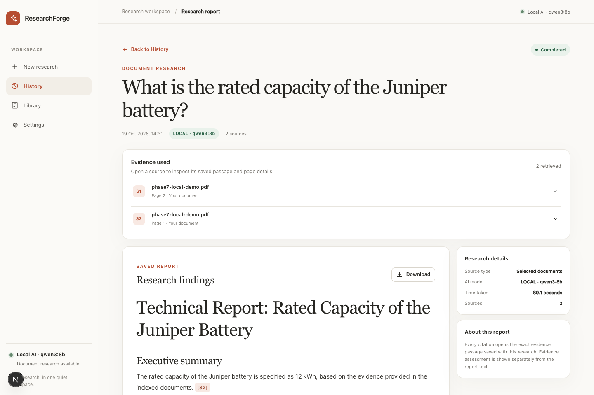
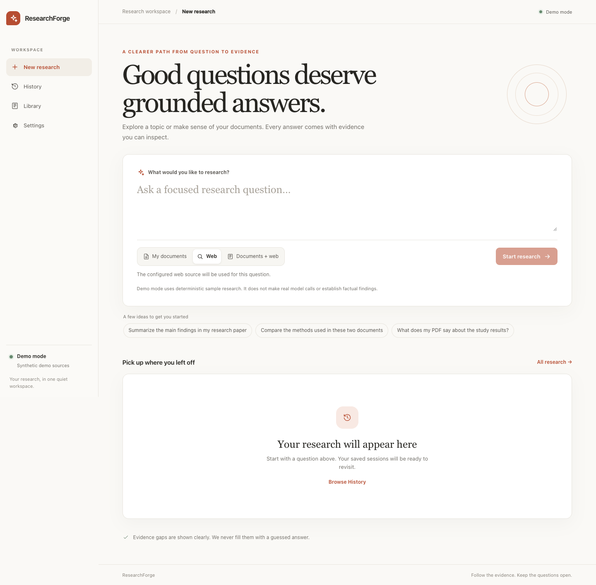

# ResearchForge AI

**A local-first Agentic AI research assistant for document-grounded answers.** ResearchForge AI combines document retrieval, a bounded LangGraph workflow, local Ollama inference, inspectable citations, and safe abstention when the selected sources do not contain an answer.

The primary portfolio demonstration is **My Documents** mode. Web and Documents + Web are implemented as experimental options; their deterministic offline integrations pass, but full real-model Web acceptance has not passed and real-model Combined acceptance has not been completed.

## The problem it addresses

Large language models can give confident answers that are not supported by the material a person is researching. ResearchForge AI makes the evidence part of the workflow: it retrieves passages from selected documents, checks whether those passages answer the requested facts, writes a cited report when they do, and can abstain when they do not.

## What is implemented

- PDF and document upload, parsing, page-aware chunking, and local indexing.
- Hybrid retrieval: BM25Plus keyword matching and Qdrant vector search, combined with reciprocal-rank fusion.
- A staged LangGraph workflow for planning, evidence collection, sufficiency assessment, report writing or abstention, claim extraction, and claim verification.
- Citation checks that require known source IDs and exact quotation matches; document citations retain page and chunk provenance.
- Saved sessions, run state, reports, and verification history in PostgreSQL.
- Local inference through the already-installed Ollama `qwen3:8b` model. The documented startup disables hosted model calls.
- A Next.js interface for research, history, document library, settings, report reading, and citation review.
- Experimental English Wikipedia search and Documents + Web retrieval, with request bounds and source provenance.

The checks validate structure and source-reference consistency; they do not guarantee that a source is correct or that every model interpretation is semantically right.

## Main demonstration: My Documents

The demo uses a synthetic PDF about a fictional Juniper battery. The answerable question is **“What is the rated capacity of the Juniper battery?”** The saved successful local run reports **12 kWh** and cites the corresponding document passage on page 1. The unanswerable question is **“What is the annual maintenance cost of the Juniper battery?”** A saved local run returned insufficient evidence rather than inventing a price.

These are saved examples of previous `LOCAL · qwen3:8b` runs, not promises that every fresh inference will succeed. Another recorded answerable run failed during verification. See the [short demo guide](docs/DEMO_GUIDE.md) for a truthful 3–5 minute walkthrough and the exact saved screenshot.





## Architecture

```mermaid
flowchart LR
  Browser[Next.js interface] --> Proxy[Same-origin API routes]
  Proxy --> API[FastAPI]
  API --> Graph[LangGraph research workflow]
  API --> DB[(PostgreSQL: sessions, metadata, reports)]
  API --> Files[Local document storage]
  Files --> Parse[Parse and chunk documents]
  Parse --> Embed[Cached local embeddings]
  Embed --> Q[(Qdrant vector index)]
  Graph --> Retrieve[Selected-document retrieval]
  Retrieve --> BM25[BM25Plus keyword search]
  Retrieve --> Q
  BM25 --> Fuse[Reciprocal-rank fusion]
  Q --> Fuse
  Fuse --> Evidence[Retrieved passages with provenance]
  Graph --> Ollama[Loopback Ollama: qwen3:8b]
  Evidence --> Suff[Evidence sufficiency]
  Ollama --> Suff
  Suff -->|supported| Draft[Draft cited report]
  Suff -->|not supported| Abstain[Abstain safely]
  Draft --> Claims[Extract and assess claims]
  Claims --> Validate[Source ID and exact-quote checks]
  Validate --> Report[Verified report]
  Abstain --> Report
  Report --> DB
```



The browser uses same-origin Next.js routes to reach FastAPI. PostgreSQL stores durable application state; Qdrant provides vector similarity search while PostgreSQL remains authoritative for document and chunk metadata. LangGraph makes workflow stages and bounded branches explicit. Ollama provides a local model path without a paid hosted inference service. See the [technical overview](docs/PORTFOLIO_TECHNICAL_OVERVIEW.md) and [security boundaries](docs/SECURITY.md).

## Run locally on macOS

Requirements: Docker Desktop, Ollama with the `qwen3:8b` model already cached, Python 3.12, and Node.js 22.13 or newer. Normal startup does not download models or install dependencies.

For a first-time checkout only, install the project dependencies with `bash scripts/bootstrap.sh`. Keep `.env` private. The demo also needs Docker Desktop and Ollama with `qwen3:8b` already installed. Then start Docker Desktop and Ollama and run:

```bash
cd /path/to/researchforge-ai
bash scripts/start_local.sh
```

Open [http://127.0.0.1:3000](http://127.0.0.1:3000). The script starts or reuses the local PostgreSQL and Qdrant services, checks that Ollama already has `qwen3:8b`, applies forward migrations, and starts or reuses the API and interface. It forces local Ollama inference and disables hosted model calls. Without a privately configured Wikimedia contact, public search stays disabled and the Documents mode remains available.

To stop only the application API and interface processes started by the helper:

```bash
bash scripts/stop_local.sh
```

PostgreSQL, Qdrant, and the Ollama service stay running. More detailed steps and the saved-result walkthrough are in [docs/DEMO_GUIDE.md](docs/DEMO_GUIDE.md).

## Example questions

With the included synthetic Juniper document selected:

- Answerable: “What is the rated capacity of the Juniper battery?” Expected supported value: **12 kWh**, with a page citation.
- Unanswerable: “What is the annual maintenance cost of the Juniper battery?” Expected behavior: report insufficient evidence; do not guess a cost.

## Validation evidence

Previously recorded checks (no new full suite was run for this documentation update):

- 185 backend unit tests passed.
- 232 PostgreSQL/Qdrant integration tests passed; 3 optional cached-model evaluations were skipped.
- 39 frontend tests and 5 browser tests passed.
- One saved local answerable Documents run completed with a page citation, and one saved local unanswerable run abstained. A separate answerable local run failed verification; these examples are not a reliability estimate.
- Deterministic offline Web and Combined integration passed through the API, workflow, verification, and persistence using explicitly synthetic web/document fixtures and fixture inference. These checks are not real-Qwen runs or real Wikipedia evidence.
- One bounded real-Qwen offline Web run stopped at evidence sufficiency after an Ollama HTTP 500. Its response detail was not retained, so the cause remains unknown. Real-Qwen Combined and successful end-to-end live Web acceptance remain unverified.

See [evaluation notes](evaluation/README.md), the [Web/Combined acceptance record](docs/LIVE_WEB_COMBINED_ACCEPTANCE.md), and the [completion checkpoint](docs/FINAL_COMPLETION_STATUS.md) for boundaries and details.

## Known limitations and next improvements

- Local model output and latency vary; the successful saved Documents run is a demonstration, not a reliability claim.
- Web and Documents + Web remain experimental pending successful real-model end-to-end validation. Wikipedia is an encyclopedia, not a general search engine; enabling it sends planned query terms to Wikimedia. Do not use these modes for confidential questions.
- The app is a single-user local workspace without authentication. Keep it bound to loopback; do not expose it to a public network.
- The small synthetic benchmarks are provisional and not independently human-reviewed. Exact quotes and citation IDs validate references, not truth.

Reasonable future work is to improve local structured-output reliability on a separate development set, evaluate on a fresh untouched set, and only then repeat bounded Web/Combined acceptance. Do not tune against held-out labels.

## Portfolio materials

- [Architecture and implementation overview](docs/PORTFOLIO_TECHNICAL_OVERVIEW.md)
- [3–5 minute demo guide](docs/DEMO_GUIDE.md)
- [Interview preparation](docs/INTERVIEW_PREPARATION.md)
- [Resume bullets](docs/RESUME_BULLETS.md)
- [Phase 8A screenshots](docs/screenshots/phase-8a/)
- [GitHub publication checklist and readiness](docs/GITHUB_PUBLICATION.md)
- [Third-party content attribution](evaluation/ATTRIBUTION.md)

The application source is under the MIT License. Third-party package and bundled-content licenses still need to be respected; see the publication checklist before publishing.
