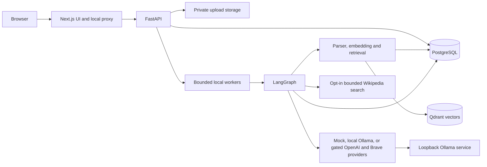
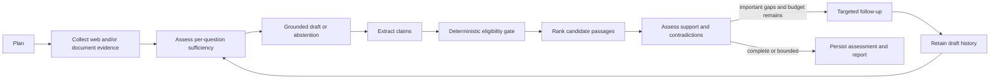

# Architecture and phased decisions

## Current scope

Phases 0–7 run as a local modular app. Next.js keeps provider settings on the server and
proxies same-origin requests to FastAPI. PostgreSQL stores sessions, document metadata and
chunks, run snapshots, reports and verification history. Qdrant stores vectors in named
collections. A bounded local worker owns one active run and uses LangGraph for research,
document retrieval and evidence assessment.

Hosted providers are disabled by default and have not been live-tested. Mock runs are
clearly labelled. Document-mode mock writing quotes actual retrieved passages, but does
not perform semantic synthesis. A completed support assessment means the defined
procedure ran; it is not a truth guarantee.

## Request and data paths

The browser calls same-origin Next.js routes. The server proxy validates loopback Host
and Origin, request shape and size, fixed paths, response fields and timeouts. FastAPI
validates again, fixes ownership to the local workspace and returns sanitized errors.
PostgreSQL readiness requires the current Alembic revision. Application startup never
creates schema.

Document ingestion streams an upload to an exclusive temporary file, checks extension,
signature, size and checksum, then atomically renames to a generated UUID storage key.
PostgreSQL records a queued document. A single local worker launches a bounded parser
subprocess, chunks extracted pages/paragraphs, creates embeddings, writes Qdrant points,
checks the indexed count, stores chunk metadata in PostgreSQL and only then marks the
document ready. PostgreSQL and Qdrant do not share a transaction; generation IDs and the
PostgreSQL ready state keep incomplete vectors out of retrieval. Reindex and delete are
explicit, retryable operations.

Retrieval filters ready chunks by local workspace, document selection, generation and
embedding revision. BM25 uses the authorized PostgreSQL chunks. Semantic search uses
Qdrant. Reciprocal rank fusion combines the two ranked lists; raw scores remain separate.
Document evidence passed into a run contains bounded excerpts plus document, chunk, page,
checksum and source IDs, not an entire file.

The research worker atomically accepts a pending session and persists a run and verification
row before starting work. The graph plans, collects only evidence allowed by the mode,
assesses sufficiency, writes or abstains, extracts and checks claims, and conditionally
performs bounded follow-up. New follow-up evidence triggers a sufficiency reassessment.
Every stage persists snapshots. Final completion and the final report are committed with
the completed verification artifact in one transaction. Cancellation, provider errors,
timeouts, invalid evidence references, and verification failure cannot be reported as a
completed run. Process restart fails stranded work without replaying external calls.

## Main modules

| Area | Main files | Responsibility |
| --- | --- | --- |
| HTTP boundary | `app/main.py`, `app/api/` | Configuration, sessions, documents, execution and verification APIs |
| Relational state | `app/db/models.py`, `backend/migrations/versions/` | Sessions, runs, documents, chunks and verification traceability |
| Document pipeline | `app/documents/parsing.py`, `embeddings.py`, `vectors.py` | Safe parsing, CPU/fake embeddings, named Qdrant collections |
| Retrieval | `app/documents/retrieval.py`, `service.py` | BM25, semantic retrieval, RRF and ingestion lifecycle |
| Research graph | `app/research/workflow.py`, `budget.py`, `supervisor.py` | Bounded routing, snapshots, cancellation and terminal transaction |
| Provider contracts | `app/research/providers.py`, `web.py` | Deterministic test providers, gated hosted adapters and guarded fetch |
| Claim assessment | `app/research/verification_schemas.py`, `verification.py` | Structured claims, eligibility audit, exact quote/source validation and assessment policy |
| Evidence sufficiency | `app/research/sufficiency.py`, `workflow.py`, `report.py` | Per-question supported/partial/missing/conflict states and safe abstention |
| Retrieval evaluation | `app/documents/evaluation.py`, `backend/tests/test_retrieval_evaluation.py` | Retrieval metrics and reproducible local benchmark |
| Answerability evaluation | `app/research/answerability_evaluation.py`, `backend/tests/test_answerability_retrieval.py` | Development-calibrated held-out threshold and abstention metrics |
| Browser UI | `frontend/src/components/` | Document workspace, run/report view and stored assessment panel |

## Storage and boundaries

The local workspace is a development boundary, not multi-user authentication. All API
queries currently filter to that one server-selected workspace. PostgreSQL remains the
authority for whether a document/chunk is ready and current. Qdrant payloads contain
workspace, document, chunk and generation IDs; results are intersected with authorized
PostgreSQL rows.

Deleting a document hides it before removing its file, vectors and chunks. Its metadata
tombstone remains to prevent accidental duplicate ingestion. Completed research reports
retain immutable evidence snapshots, so deleting an upload does not erase prior reports
or backups. There is no retention scheduler or full-erasure guarantee.

The PDF parser uses pypdf (BSD-3-Clause); DOCX uses python-docx (MIT); embeddings use
FastEmbed/ONNX on CPU (Apache-2.0); BM25 uses rank-bm25 (Apache-2.0); Qdrant is
Apache-2.0. The selected quantized BGE small English model is about 67 MB published and
occupied about 64 MiB in the local cache. The fake 64-dimensional embedding provider is
deterministic and has no semantic quality claim. No Torch/CUDA dependency is required.

## Operations and later work

PostgreSQL and Qdrant are loopback-only Compose services, each with a 512 MiB memory limit
and one CPU. The native app processes use bounded pools, request timeouts, parser limits,
provider budgets and one local worker. Qdrant is a required local service for semantic and
hybrid retrieval; BM25-only retrieval remains separately available.

The app is unauthenticated and should not be deployed publicly. Later work requires
authentication, full workspace authorization, CSRF protections if cookies are introduced,
network egress controls, parser isolation, deletion/retention policy, and representative
evaluation before any real-world verification claims. Native LangGraph checkpoint resume,
OCR, multilingual embeddings and live research quality remain future work.

See [Phase 3](PHASE_3.md), [Phase 4](PHASE_4.md), [Phase 5](PHASE_5.md), [Phase 6](PHASE_6.md), and
[security boundaries](SECURITY.md) for implementation details and test commands.

## Phase 7 local provider and fact-level checks

Ollama is a separate `local` execution mode. Its HTTP endpoint is validated as loopback,
the client disables proxies and redirects, and structured responses use a fixed schema,
bounded context/output, timeouts and one repair retry. There is no provider fallback.
Usage stores local token and inference measurements while cost remains zero. The browser
displays the provider/model mode and distinguishes local runs from synthetic mock runs.

The sufficiency schema includes one assessment for each requested fact, with fields for
entity, property, value, units, time, scope, negation, status and source quotations. The
backend verifies quote substring and source-ID consistency. This is stronger citation
plumbing, not semantic proof: a fluent model can still misread the question or quote. A
free search adapter is optional English Wikipedia API access, not a generic open-web search.
It is off by default, requires a public contact in the User-Agent, rate-limits queries,
and fetches pages through the existing SSRF-safe HTTP path. See [Phase 7](PHASE_7.md).
