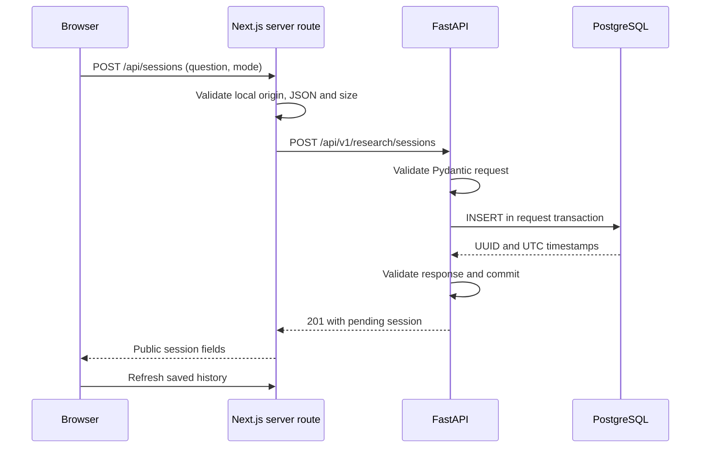

# Phase 1 — persistent research sessions

This guide describes the Phase 1 milestone. Phase 2 now adds explicitly configured web
execution; see [the current Phase 2 guide](PHASE_2.md). Document execution remains unavailable.

## What changed

You can now enter a question, choose web/documents/combined mode, save it in PostgreSQL,
browse paginated history, and inspect an individual session. Every newly saved session
is `pending`. Saving a question does **not** search the web, run an agent, attach documents,
or produce a report. Document mode records your intended future workflow only.

The existing dashboard design and Phase 0 health/configuration features are preserved.
The API's `/health` checks liveness; `/ready` independently checks PostgreSQL and the
expected migration. A database outage must not make process liveness appear unhealthy.

## Why these database tools exist

**PostgreSQL** stores information outside the Python process. An in-memory list disappears
when the server restarts; a committed PostgreSQL row survives an API restart. The local
database uses a Docker named volume, so stopping its container retains the database files.

**SQLAlchemy** translates typed Python model/query operations into parameterized SQL and
manages transactions and connection pooling. `ResearchSession` represents a table row.
Each request gets its own async session; it is never shared between concurrent requests.
The pool is limited to three connections with no overflow for this local application.

**Alembic** records database structure changes as versioned migrations. Migration
`0001_sessions` creates the session table and history index. Running `upgrade head`
applies missing migrations; it does not reset existing rows. Application startup never
calls `create_all`. Autogeneration is restricted to this application's known tables,
so it does not propose dropping an unrelated table. Deliberate table removals will
require explicitly reviewed migrations.

## Database design

| Field | Meaning |
| --- | --- |
| `id` | Server-generated UUID |
| `workspace_id` | Server-selected `local`; not accepted from the client |
| `question` | Trimmed text, 10–4,000 characters |
| `mode` | `web`, `documents`, or `combined` |
| `status` | `pending`, `running`, `completed`, `failed`, or `cancelled` |
| `created_at`, `updated_at` | PostgreSQL timestamps with time zone; API connections use UTC |
| `error_message` | Nullable bounded string, unused by new pending sessions |

Database constraints enforce question length and mode/status values. All read queries
filter the server's local workspace. This is preparation for authorization, **not** a
multi-user security system. There is no public status-update or deletion endpoint.
The ORM updates `updated_at` on future application updates; direct SQL changes would
need to set it explicitly. No mutable session behavior exists in Phase 1.

History is sorted by `created_at DESC, id DESC`, including deterministic ordering when
timestamps tie. Pagination uses `limit` (1–50) and `offset` (0–10,000). New inserts can
shift offset-based pages; refresh from the first page to see the newest sessions.

## What happens when you click Save session



The browser calls its own origin. Only the Next.js server knows `BACKEND_URL`; only the
Python server knows `RF_DATABASE_URL`. The frontend never connects to PostgreSQL or
receives its password. The API commits before returning success. Failure before commit
rolls back; a driver failure returns a sanitized 503. The UI keeps your question on error.

There is no automatic retry for a write. If a response is lost after a commit, the save
may have succeeded. Refresh history before trying again to avoid an unintended duplicate.
Repeated intentional saves create separate sessions; upload deduplication is future work.

## Start on your Mac

In VS Code, open `/path/to/researchforge-ai`. Run from the repository root:

```bash
bash scripts/bootstrap.sh
docker compose --profile infrastructure up -d --wait postgres
backend/.venv/bin/alembic -c backend/alembic.ini upgrade head
backend/.venv/bin/alembic -c backend/alembic.ini current
```

Expected migration revision: `0001_sessions (head)`. Bootstrap preserves an existing
`RF_DATABASE_URL`; if missing, it constructs one from your existing Compose values and
appends it to the ignored `.env`, without printing it. `POSTGRES_PASSWORD` and the
password encoded in `RF_DATABASE_URL` must match. Changing an existing container's
environment password does not change its already initialized database password.
Never remove a data volume to fix credentials. Inspect and correct configuration first.

Only `postgres` is started by the command above. Do not start Qdrant for this phase.
The cached ARM64 PostgreSQL image was used locally; a clean machine may download it.
PostgreSQL is limited to 512 MiB RAM and one CPU; the app processes run natively.

Terminal 1, repository root:

```bash
backend/.venv/bin/python -m uvicorn app.main:app --app-dir backend --reload --reload-dir backend/app --host 127.0.0.1 --port 8000 --no-access-log
```

Terminal 2:

```bash
cd /path/to/researchforge-ai/frontend
npm run dev
```

Open <http://127.0.0.1:3000>. Enter “How does retrieval improve grounded answers?”, choose
a mode, and click **Save session**. You should see a pending confirmation, a history row,
and details containing a UUID and timestamps. Click a history row to load its detail
from the API; **Refresh status** fetches the current saved status. It stays pending in
this phase. **Next/Previous** navigate history; **Refresh history** retries a failed load.

Stop application servers with Ctrl+C in their terminals. To stop only the database while
retaining its volume: `docker compose --profile infrastructure stop postgres`.

## API commands and persistence inspection

```bash
curl -i http://127.0.0.1:8000/health
curl -i http://127.0.0.1:8000/ready
curl http://127.0.0.1:8000/api/v1/config
curl -i -X POST http://127.0.0.1:8000/api/v1/research/sessions \
  -H 'Content-Type: application/json' \
  -d '{"question":"How does retrieval improve grounded answers?","mode":"web"}'
curl 'http://127.0.0.1:8000/api/v1/research/sessions?limit=5&offset=0'
```

Copy the real UUID returned by POST and request
`http://127.0.0.1:8000/api/v1/research/sessions/YOUR_UUID`. Unknown UUIDs return 404;
malformed UUIDs, invalid modes or questions return 422 when the database is available.
The list response has `items`, `total`, `limit`, `offset`, and `has_more`. A separate
status endpoint is unnecessary because the detail response already includes status.
Interactive OpenAPI is at <http://127.0.0.1:8000/docs>.

To verify persistence manually, save a session and note its UUID, stop **only the API**,
restart it with the command above, then retrieve that UUID again. The data should match.
Reload the dashboard and select the saved row. Automated tests additionally perform a
real API subprocess stop/restart against a disposable PostgreSQL database.

## Run verification

```bash
cd /path/to/researchforge-ai
bash scripts/check.sh
backend/.venv/bin/python scripts/test_database.py
backend/.venv/bin/python scripts/test_database.py --browser
```

The first command runs static checks, 33 offline backend tests, frontend behavior tests,
a production build, and Compose validation. It needs no database or paid provider.
The second command creates a uniquely named `rf_test_*` database on your local server,
runs all backend tests including real SQL, migrations and process restart, then removes
only that database. The local development role needs `CREATEDB`; the Compose role has it.
No development session rows are reset by these tests.

The third command creates a different disposable database, migrates it, and runs browser
tests on ports 3100/8100 against the **production frontend build** and actual API. It never
reuses your development server or database. Close anything else on those test ports;
there is no automatic killing of existing processes. Build first using `check.sh`.
The local tests use installed Chrome. CI installs Playwright Chromium; an optional local
alternative is `cd frontend && npx playwright install chromium`, followed by the root
runner with `PLAYWRIGHT_CHANNEL=chromium`. That browser download is not required here.

Direct Pytest runs without `RF_TEST_DATABASE_URL` skip the database-marked tests explicitly.
Use the runner above to verify PostgreSQL. A skipped test is not a passed persistence check.
An interrupted test runner may leave its uniquely named scratch database; inspect it
before removing it manually. No broad database or Docker cleanup commands are used.

Migration inspection commands:

```bash
backend/.venv/bin/alembic -c backend/alembic.ini current
backend/.venv/bin/alembic -c backend/alembic.ini history
backend/.venv/bin/alembic -c backend/alembic.ini check
```

Do not downgrade the development database to test rollback. The test suite exercises
`downgrade base → upgrade head` only in its disposable database, checking that an unrelated
sentinel table survives and that the final schema matches the SQLAlchemy models.

## Study these files first

1. `backend/app/schemas/sessions.py`: what valid requests and responses look like.
2. `backend/app/db/models.py`: how a session maps to a PostgreSQL row.
3. `backend/app/db/session.py`: pool limits and request transaction lifetime.
4. `backend/app/services/sessions.py`: parameterized create/list/detail operations.
5. `backend/app/api/sessions.py`: HTTP routes and status codes.
6. `backend/migrations/versions/0001_sessions.py`: the first schema change.
7. `frontend/src/components/session-workspace.tsx`: form, history and detail state.
8. `frontend/src/app/api/sessions/route.ts`: the server proxy and input/origin boundary.
9. `backend/tests/test_process_persistence.py`: actual restart verification.

## Troubleshooting and limits

| Symptom | What to inspect |
| --- | --- |
| `/health` 200 but `/ready` 503 | PostgreSQL startup, credentials, and `alembic current`; liveness is intentionally independent. |
| Database unavailable in history | Start only PostgreSQL, apply migrations, restart the API after changing `.env`, then refresh history. |
| Password authentication failed | Keep Compose credentials and `RF_DATABASE_URL` aligned; URL-encode special password characters. Preserve existing volumes. |
| Save returns 403 | Use the local app URL and matching browser origin; cross-site writes are intentionally rejected. The proxy validates the actual Host because Next.js can normalize its request URL. |
| Duplicate session after retry | A previous response may have been lost after commit; inspect history first. No write idempotency key is implemented yet. |
| Session remains pending | Expected: the research engine does not exist in Phase 1. |
| Test asks for a disposable database | Run `scripts/test_database.py`; do not point tests at your development database. |
| Test ports in use | Stop the corresponding process in its own terminal or inspect it with `lsof`; tests refuse to reuse unrelated servers. |

This remains unauthenticated, single-user localhost development. Workspace filtering is
tested but is not user authentication. Public deployment, live agent research, uploads,
provider costs and retrieval quality are outside this phase. Hosted CI remains unverified
until an authorized GitHub push. See `IMPLEMENTATION_LOG.md` for actual results and limits.
