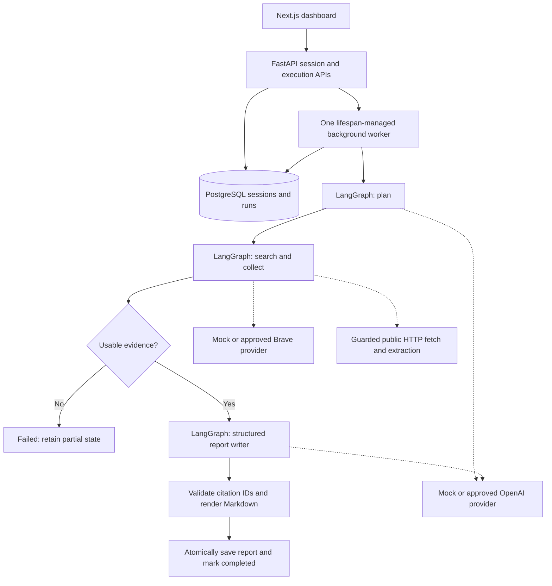

# Phase 2 — bounded web research baseline

## What is implemented and what is verified

Phase 2 adds a typed LangGraph workflow, LLM/search provider interfaces, deterministic
offline providers, an optional OpenAI Responses adapter, a Brave Search adapter, guarded
page extraction, evidence provenance, citation-ID validation, Markdown reports and
background execution connected to the existing dashboard and history.

**The complete mock workflow is verified locally. Live OpenAI/Brave calls have not been
made or verified.** Hosted adapters have offline request/response contract tests only.
No real research quality, model accuracy or provider availability has been measured.
Mock evidence is synthetic, clearly labelled, and cannot answer your real question.

Only sessions saved with `mode=web` can execute. Document and combined modes can still
be saved, but execution returns 422 without changing their pending status. Uploads,
RAG, Qdrant and advanced claim verification remain outside this phase.

## Understand the architecture



An **LLM provider** is an adapter that implements planning and report-writing operations.
The application depends on that contract, rather than scattering SDK calls across routes.
`MockLLM` is deterministic Python code; `OpenAILLM` sends requests only in explicitly
approved live configuration. Model names are restricted to the implemented capability
registry (`gpt-4.1-mini`, `gpt-4.1`); unsupported models fail configuration validation.
No local model is required, installed, or claimed supported yet.

**LangGraph** connects typed state and nodes with explicit routes. It is useful here
because plan, evidence, failure and report stages have different responsibilities and
failure rules. It is not a loop asking one model to do everything. The graph has three
successful stages and a conditional insufficient-evidence route, with a recursion limit.

The workflow is **agentic** in a bounded sense: the hosted planner interprets the objective
and proposes the subquestions and search queries that determine subsequent tool use.
Python controls which tools exist, how often they run, what they can access, and whether
evidence permits report generation. No shell, arbitrary code, browser control or
filesystem tools are exposed to the model.

## Planner, tools and report writer

The hosted planner uses one strict `submit_plan` function call. Its JSON arguments must
validate as a `ResearchPlan`: an objective, scope and **1–5** focused subquestions, each
with one search query. A single-fact request can use one subquestion; split only when the
user asks for distinct facts. The plan is revalidated and saved before collection. Invalid
structured output fails the run; it is not silently replaced by model knowledge.

The collector executes only the bounded plan queries through `SearchProvider.search`.
Brave returns candidate titles/URLs; snippets alone are not treated as extracted source
evidence. The collector normalizes URLs, rejects unsafe targets, fetches public page
content, strips navigation/scripts/styles/forms, and selects a bounded excerpt using
a simple lexical-overlap heuristic. This is a baseline, not an evaluated relevance model.
Canonical URLs and content hashes remove duplicates. Successful investigated queries,
excluded-source warnings, plan and accepted sources are persisted as progress snapshots.

The writer receives only bounded evidence data and the objective. Retrieved content is
explicitly untrusted data. It has no tools. Its structured factual statements require
source IDs. Python rejects any citation ID absent from the collected source set, escapes
generated text, and constructs references from stored URLs. Missing evidence routes to
failure before the writer; no report is fabricated.

Citation-ID correctness does **not** prove that a passage entails a claim or that a claim
is true. Semantic claim verification belongs to later phases. The report always states
this limitation. There are no fabricated factual evaluation scores.

## Persistence and provenance

Migration `0002_research_runs` adds one run per session, preserving existing session rows.
Each run retains its worker ID, mock/live mode, provider model, prompt version, stage,
plan, sources, investigated queries, warnings, usage, timestamps and eventual report.
Bounded evidence is stored as typed JSONB in the run; a separate vector or document store
is not needed for this phase. Prompt version is `web-baseline-v1`.

Each accepted source retains `source_id`, session UUID, `web`/`mock` type, title, normalized
final URL, retrieval timestamp, excerpt, full extracted-text SHA-256 and originating query.
Publication dates remain null: the current baseline does not independently verify them.
Retrieval time must never be presented as publication time.

Reports contain title, executive summary, objective, methodology, findings, comparison
where justified, limitations, conclusion and references. JSON and Markdown are committed
with the terminal session status in one transaction. The UI displays Markdown as escaped
text, never raw HTML, and offers a `.md` download. PDF export is not implemented.

## Safe execution and interruption

Creating a session still returns 201/pending. Execution requires a separate explicit POST
with `execution_mode=mock` or `live`; it returns **202** and starts an owned background task.
Long research does not occupy an unbounded HTTP request.

Allowed transitions are `pending → running → completed` or `running → failed`.
Pending/running sessions can be cancelled; a cancelled session cannot be overwritten by
a late completion. Failed or completed runs cannot be replayed on the same session.
Cancellation cannot undo provider requests already sent or refund their charges.
Create a new session for an intentional retry. Lost responses should be followed by a
status refresh before another request.

There is one worker and no queue. An in-process guard rejects overlapping starts; a
PostgreSQL session advisory lock prevents a second API worker from executing or recovering
the first worker's runs. The row lock, pending-status check and unique session/run mapping
prevent duplicate execution. Run the API with **one worker**.

Stage snapshots survive failures. A worker that acquires ownership on restart marks
stranded running runs failed/interrupted, retaining evidence. It does **not** replay paid
calls or resume graph nodes automatically. These are persisted application snapshots,
not a claim of resumable LangGraph checkpoint execution. Database outages can delay failure
persistence until a later ownership recovery; never interpret a stale running row as proof
that work is still executing.

The default limits are:

| Resource | Default |
| --- | --- |
| Concurrent active research runs | 1; additional starts rejected |
| Graph recursion limit | 8 |
| Planned subquestions/search queries | 1–5 / at most 5 unique queries |
| Accepted sources | At most 5 |
| Search/fetch attempts, including retries | At most 18 total |
| Provider timeout / transient retries | 15 seconds / 1 retry |
| Graph execution deadline | 120 seconds |
| Per-page bytes / stored excerpt | 512,000 / 1,500 characters |
| Writer input data | At most 16,000 characters; oversized context fails explicitly |
| LLM output per call | At most 1,500 tokens |

There are two logical LLM calls. At default retries there can be at most four attempts;
invalid schema/citation responses are not retried. Redirects are manually bounded to
three per page attempt, and every target is revalidated. Tool attempts and HTTP redirects
are distinct counters. Provider closure and shutdown cleanup have separate bounded waits.
Query/source caps can leave planned questions unsearched; this is disclosed in limitations.

## Cost and approval boundary

Defaults are `RF_LLM_PROVIDER=disabled`, `RF_SEARCH_PROVIDER=disabled` and
`RF_LIVE_CALLS_APPROVED=false`. Tests and the free demonstration use `mock/mock`.
Mixed mock/live pairs are rejected so a synthetic source set cannot look like live research.

The optional `openai/brave` pair requires backend API keys and a supported model. It stays
disabled without the separate live-approval flag. No credentials or approval flag were
enabled for hosted execution during implementation. ChatGPT Plus does not supply API credits.

Hosted OpenAI requests can incur input/output-token charges; Brave searches can incur
per-request charges under the account's plan. Retries can add charges. Before a live test,
review the current [OpenAI model/pricing page](https://developers.openai.com/api/docs/models/gpt-4.1-mini)
and [Brave account documentation](https://api-dashboard.search.brave.com/app/documentation),
agree on a spend limit and obtain explicit approval. No price or free tier is assumed.

The stored estimate covers **LLM tokens only**, using explicitly supplied current
`RF_INPUT_USD_PER_MILLION` and `RF_OUTPUT_USD_PER_MILLION`. It excludes search charges,
cache discounts, taxes and unreported requests; it is not an invoice. Without prices or
complete provider usage, cost is unavailable rather than zero. Unknown usage after an
error is flagged incomplete. Mock token usage/cost is zero because no provider was called.

## Start and run a free demonstration on your Mac

From the repository root:

```bash
cd /path/to/researchforge-ai
bash scripts/bootstrap.sh
docker compose --profile infrastructure up -d --wait postgres
backend/.venv/bin/alembic -c backend/alembic.ini upgrade head
backend/.venv/bin/alembic -c backend/alembic.ini current
```

Expected revision: `0002_research_runs (head)`. No existing session rows are reset.
Stop the previous API terminal with Ctrl+C before starting another instance.

Terminal 1 — explicitly configure only mock providers for this process:

```bash
RF_LLM_PROVIDER=mock RF_SEARCH_PROVIDER=mock RF_LIVE_CALLS_APPROVED=false \
backend/.venv/bin/python -m uvicorn app.main:app --app-dir backend \
  --reload --reload-dir backend/app --host 127.0.0.1 --port 8000 --no-access-log
```

Terminal 2:

```bash
cd /path/to/researchforge-ai/frontend
npm run dev
```

Open <http://127.0.0.1:3000>, choose **Web**, save a question, then click **Run mock
demonstration** in its details. The banner states synthetic fixtures/no live research.
You should see a plan, searched-query labels, two mock source passages, a completed stage
and a Markdown report. The report intentionally does not claim to answer your real question.
Reload and select that history row: the plan, sources and report are loaded from PostgreSQL.
Use **Export Markdown** to download it. Live runs cannot be started with these settings.

To run with all execution disabled, omit the three environment prefixes. To persist mock
configuration, set both provider values to `mock` in the ignored root `.env` and restart
the API. Never put provider keys or database URLs in `frontend/.env.local` or `NEXT_PUBLIC_`.

## API example and status inspection

Use `/docs` or POST a web session as in Phase 1, then copy its actual UUID:

```bash
# Replace YOUR_SESSION_UUID with the UUID returned by session creation.
curl -i -X POST http://127.0.0.1:8000/api/v1/research/sessions/YOUR_SESSION_UUID/execute \
  -H 'Content-Type: application/json' -d '{"execution_mode":"mock"}'
curl http://127.0.0.1:8000/api/v1/research/sessions/YOUR_SESSION_UUID/run
curl http://127.0.0.1:8000/api/v1/research/sessions/YOUR_SESSION_UUID
curl -OJ http://127.0.0.1:8000/api/v1/research/sessions/YOUR_SESSION_UUID/report
```

Cancellation uses POST `.../cancel` with JSON `{}`. A missing report returns 404; a second
execution or busy worker returns 409; document execution returns 422; disabled providers
or an unavailable worker return 503. The UI polls active runs without overlapping requests
and stops automatic polling after four minutes; manual session refresh reloads persisted state.

## Test and inspect

```bash
bash scripts/check.sh
backend/.venv/bin/python scripts/test_database.py
backend/.venv/bin/python scripts/test_database.py --browser
```

The first command runs static checks, database-independent tests and a production build.
The second runs the full backend suite in a fresh PostgreSQL scratch database. The third
uses another scratch DB and separate test ports 3100/8100, explicitly configures mock
providers, and tests the production frontend/API/browser path. Existing development rows
are not reset. Hosted SDK/search tests replace network methods with mocks; no keys are
needed. LangSmith tracing and its pytest plugin are disabled for these workflows/tests.

See `IMPLEMENTATION_LOG.md` for executed results. Browser captures in `docs/screenshots`
show actual mock execution, not real web findings. Automated tests cover correctness of
control flow and data contracts; they do not measure live research quality.

## Files to study first

1. `backend/app/research/schemas.py`: plan, evidence, grounded statement, report and usage contracts.
2. `backend/app/research/providers.py`: provider interfaces, mock fixtures, OpenAI/Brave adapters and prompts.
3. `backend/app/research/workflow.py`: typed graph, tool use, deduplication and conditional failure routing.
4. `backend/app/research/web.py`: URL normalization, connection-time DNS filtering, extraction and excerpt selection.
5. `backend/app/research/report.py`: citation membership checks and safe Markdown construction.
6. `backend/app/research/supervisor.py`: atomic acceptance, worker ownership, cancellation and recovery.
7. `backend/app/api/execution.py` and migration `0002_research_runs.py`: HTTP and persistence boundaries.
8. `frontend/src/components/run-panel.tsx`: explicit start, progress, plan, sources, report and export.
9. `backend/tests/test_execution_postgres.py`: real SQL-backed state transitions and isolation checks.

## Known limitations and troubleshooting

- Hosted adapters are **not live-verified**. Credentials, account/model access, API acceptance,
  real-world extraction quality and cost must be validated after approval.
- Read-only public HTML/plain-text pages are supported. PDF, OCR, authenticated pages,
  compressed responses and JavaScript-only content may be excluded; there is no bypass.
- SSRF tests use mocked DNS/HTTP to safely exercise blocked targets; no internal services
  were probed. A public deployment still requires authentication and network egress controls.
- “Worker unavailable” can mean another API process owns the database advisory lock.
  Use one API worker and stop the older process in its own terminal; do not kill unknown processes.
- `/health` 200 with `/ready` 503 means the process is alive but PostgreSQL/migrations need attention.
- “No usable evidence” is an expected failed run with no fabricated report. Partial state remains inspectable.
- Live pricing is deliberately unset. Do not replace “unavailable” cost with an invented number.
- There is no native graph resume, advanced claim verification, document ingestion, Qdrant,
  hybrid retrieval, PDF export or public deployment. Phase 2 stops here.
