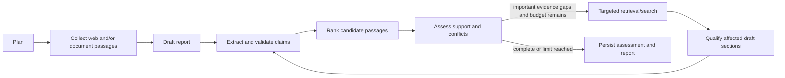

# Phase 4 — claim assessment and adaptive research

Phase 4 adds a mandatory evidence-support assessment after a report draft. The workflow
extracts checkable claims, validates them against report locations and source references,
retrieves a bounded candidate set from evidence collected for that run, and asks the
configured provider to classify the evidence relationship. Every returned quote and source
ID is checked against the stored passages. A model that omits a report location, invents a
quote, cites an unknown source, or labels a claim supported without a support passage
causes the run to fail. A failed mandatory assessment never becomes a completed report.

`SUPPORTED` means the defined procedure found evidence that appears to support the claim.
It does not establish that the claim is true. `CONTRADICTED` requires a directly opposed
passage; `INSUFFICIENT_EVIDENCE` covers ambiguity, conflicting sources, missing/invalid
citations and evidence gaps; `NOT_EVALUATED` is used for subjective or non-checkable text.
No uncalibrated confidence scores are shown.

## Workflow



The local default is one verification iteration and at most one follow-up web query. The
validated settings cap iterations at two, follow-up searches at two, LLM calls at 24, total
reported tokens at 60,000, estimated configured LLM cost at $5, tool calls at 40, sources
at eight, and wall time at three minutes. The standard defaults are lower. Search-provider
charges are separate from the LLM estimate. Missing token usage makes the estimate
unavailable. Cancellation stops future stages but cannot undo requests already sent or
charges already incurred.

The graph retains the original report, revised drafts, each assessment pass, candidate
source IDs, contradictions, and activity notes. A gap or disagreement is marked in the
revised report and retained as a limitation. The system does not remove contrary passages
or automatically favor a newer source. Completion and the final report are committed in
the same PostgreSQL transaction as the completed assessment. Verification artifacts are
available at `GET /api/v1/research/sessions/{session_id}/verification`; API and UI reads
are scoped to the local workspace.

## Teaching guide

1. **Claim extraction** turns report paragraphs into small statements that can be checked.
   Each claim keeps its report location and the citation IDs assigned by the writer. The
   live provider returns structured Pydantic output; Python checks that every report
   location is represented and that claim wording and citations came from that location.
2. **Claim verification** compares each claim with passages collected in the same run.
   A lexical overlap ranker selects at most eight candidate evidence IDs. It only chooses
   passages to inspect; it never decides support. The assessment provider must return exact
   passage quotes. Python validates each quote and source ID against the run's actual
   evidence before storing a verdict.
3. **Citation existence vs. support:** an ID can point to a real source while the source
   says nothing about the claim. For example, a report can cite a real passage about a
   battery while claiming the battery stores 20 kWh; only a passage that supports that
   capacity can justify `SUPPORTED`. Missing, irrelevant or invalid references remain
   `INSUFFICIENT_EVIDENCE`.
4. **Contradictions** are possible incompatible statements from separate passages. The
   output retains both quotes, source IDs, observation times, known publication times and
   a context caveat. Different periods or definitions may explain an apparent conflict;
   recency alone does not decide reliability.
5. **Adaptive research** routes important unsupported or contradicted claims to a
   follow-up node when the mode and budgets permit it. That node may query selected
   documents and/or issue targeted web searches. It revises affected statements to say
   their support remains unresolved, retains the original draft, then runs assessment
   again. The graph ends at a configured iteration, token, tool, cost or time limit.
6. **LangGraph routing** uses conditional edges after assessment. Python checks whether an
   important checkable claim is unsupported; it does not ask an unconstrained agent to
   choose whether to keep researching. If mandatory extraction or assessment fails, the
   graph raises a safe failure and the API does not expose a completed report.
7. **Budgets** limit latency, provider cost, database load and accidental loops. The
   configured cost is only an estimate for the LLM when explicit per-token prices and
   complete usage are available; it excludes web search charges and taxes.
8. **Evaluation** uses 12 manually labelled small fixtures, including supported,
   contradicted, missing/invalid citation, prompt-injection and ambiguity examples. The
   deterministic mock procedure is measured against those labels. Its observed perfect
   fixture scores only show that those controlled cases follow the chosen policy. It does
   not establish paraphrase handling or live model accuracy. There is no calibrated score.
9. **Files to study:** start with `app/research/verification_schemas.py`, then
   `verification.py`, the verify/follow-up nodes in `workflow.py`, the persistence and
   final transaction in `supervisor.py`, the verification route in `api/execution.py`,
   and `frontend/src/components/verification-panel.tsx`.

## Run a mock assessment

Start PostgreSQL and Qdrant, apply migrations, then start the backend and frontend as
described in the [README](../README.md). Keep `RF_LLM_PROVIDER=mock`,
`RF_SEARCH_PROVIDER=mock`, and `RF_LIVE_CALLS_APPROVED=false`. Upload a small text file
that includes a plainly checkable statement, wait for `ready / indexed`, select it, create
a Documents-mode session and explicitly run the mock demonstration. The UI shows a
`MOCK ASSESSMENTS` notice, retrieved passage, support status, report location, method,
timestamp and any retained draft/history. This demonstrates storage and provenance; the
mock verdict is a test output, not a real-world verification.

To run the labelled policy cases and refresh the recorded measurements:

```bash
backend/.venv/bin/python -m pytest -c backend/pyproject.toml backend/tests/test_verification.py -k evaluation_records_actual_mock_metrics
```

For the real database and browser path, use the scratch-resource runners:

```bash
backend/.venv/bin/python scripts/test_database.py -k verification
backend/.venv/bin/python scripts/test_database.py --browser
```

The browser suite writes only to a disposable PostgreSQL database and an isolated Qdrant
collection. See `evaluation/claim-verification-labels.json` and
`evaluation/phase-4-results.json` for cases and observed fixture metrics.

## Limits

Mock extraction and assessment are deterministic narrow rules; they intentionally abstain
on paraphrases. The hosted OpenAI structured-output path is implemented but has not been
called, so its quality, cost and failure behavior against real research corpora remain
unmeasured. A support assessment cannot prove truth, source independence, source authority
or comprehensive coverage. Retrieval only sees passages collected for that research run;
it does not perform a global evidence search for every claim. Contradiction detection is
model-assisted and can miss conflicts. Prompt-injection defenses are tested but cannot
guarantee a model will ignore malicious evidence. The application is still local and
unauthenticated.
