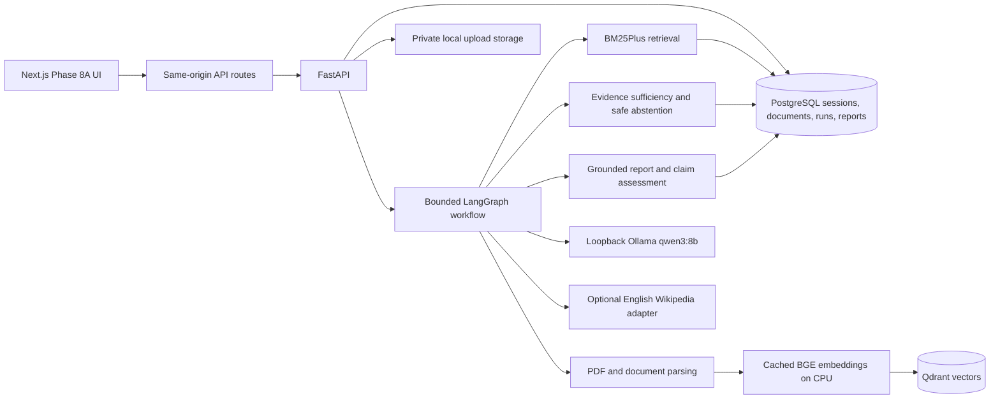

# ResearchForge AI — Technical Portfolio Overview

## Project summary

ResearchForge AI is a single-user, local-first research workspace. It turns a user question
and selected source material into a bounded research run with a saved report, source
passages, and a separate claim-support assessment. The intended portfolio demonstration is
the local document workflow; Web and Documents + Web are implemented but their full
offline local-model acceptance is incomplete.

## Engineering objectives

- Keep document content, reports, and local inference on the user's Mac by default.
- Make each report statement traceable to retrieved evidence.
- Abstain when the retrieved passages do not answer the requested facts.
- Keep research execution bounded by request, token, source, timeout, and retry limits.
- Preserve sessions and intermediate verification artifacts for inspection.
- Distinguish synthetic mock runs, local Ollama runs, and hosted live runs.

## Architecture

The browser talks to same-origin Next.js routes. Those routes proxy a narrow API surface to
FastAPI, where provider configuration and any optional credentials stay server-side.
PostgreSQL owns session, document, run, report, and verification state. Uploaded files are
stored under generated local names. Qdrant stores vectors; PostgreSQL remains authoritative
for document readiness, page text, generation, and chunk identifiers.

The workflow uses LangGraph to make stages and branching explicit: plan, gather evidence,
assess sufficiency, write or abstain, extract report claims, assess their support, and
optionally perform bounded follow-up. Stage snapshots are persisted. A run is completed
only when its report and verification state are saved together.

## Retrieval and evidence design

The document pipeline parses pages, creates bounded text chunks, computes embeddings with
the already-cached BGE small English model, and stores vectors in a named Qdrant collection.
Retrieval filters to ready chunks from the selected local workspace, current document
generation, and matching embedding revision. BM25Plus lexical results and Qdrant semantic
results are combined with reciprocal-rank fusion. Selected document IDs are enforced before
the passages enter the workflow. Combined retrieval keeps document and web source types and
their provenance separate.

Evidence sufficiency is assessed per requested fact with fields for the entity, property,
value, unit, time, scope, negation, status, and supporting passages. Accepted supporting
quotes must be exact substrings of the cited excerpt, and source IDs must exist. A bounded
repair can request a fresh structured response after invalid output. The server still
checks the repaired result; ambiguous or fabricated text cannot pass. Missing support leads
to a partial answer or abstention according to the fact-level statuses.

Claim verification extracts factual report claims, applies deterministic eligibility and
candidate-evidence rules, and stores structured assessments and contradictions. Exact quote
and citation checks establish reference consistency, not whether a source is correct or
whether a model understood it. The system does not guarantee truth.

## Why these choices

- **LangGraph:** the workflow has explicit stages, bounded retry/follow-up branches, and
  state that is useful to persist and debug. It avoids hiding an entire research run in one
  opaque model call.
- **Hybrid retrieval:** lexical matching helps exact names and numbers; vector retrieval
  can retrieve semantically similar passages. Reciprocal-rank fusion combines ranks without
  assuming the two raw scores share a scale.
- **Local Ollama:** the cached `qwen3:8b` model provides a no-paid-API execution path. The
  adapter uses loopback-only HTTP, structured schemas, bounded context and output, and no
  hosted fallback.
- **PostgreSQL plus Qdrant:** PostgreSQL is the source of truth for durable application
  state, while Qdrant handles vector similarity. Readiness and generation checks keep stale
  vector results from becoming authorized evidence.
- **Strict validation:** structured model output is treated as untrusted input. Citation
  IDs, exact quotes, fact statuses, and final persistence are checked independently of the
  model prompt.

## Failure handling and operational safeguards

Research execution has a per-run limit for public search, article fetches, total outbound
attempts, model calls, tokens, and elapsed time. Failed fetches consume the request budget;
external retry limits are separate from local output-repair limits. Wikipedia redirects
are disabled in the bounded acceptance configuration. If a provider or verification stage
fails, the run is persisted as failed instead of being presented as completed.

The current app is for one local workspace and has no authentication. It should remain
bound to loopback and must not be exposed publicly. If optional Wikipedia search is enabled,
planned search terms leave the Mac and are sent to Wikimedia; do not submit confidential
questions in Web modes.

## Evaluation and observed results

Keep these evidence types separate:

1. **Deterministic tests:** offline unit, provider-contract, request-budget, citation, and
   workflow tests. Latest full static/unit check: 185 backend tests and 39 frontend tests
   passed. The PostgreSQL/Qdrant runner passed 232 tests; 3 optional cached-model
   evaluations were skipped. All 5 browser tests passed with mock-mode test services.
2. **Real local Documents mode:** one answerable run produced a page 1 citation for the
   synthetic Juniper PDF's `12 kWh` value. One unanswerable maintenance-cost question
   returned insufficient evidence. Another answerable run failed during verification, so
   this is a successful demonstration, not a reliability estimate.
3. **Saved Wikipedia evidence:** a prior run collected genuine English Wikipedia evidence.
   That proves retrieval occurred, not that a Web report completed.
4. **Web deterministic offline:** the full API/LangGraph/sufficiency/report/verification/
   persistence flow passed historically with saved Wikipedia evidence and fixed inference
   fixtures. The current bundled regression has been changed to original synthetic web text
   and an `.invalid` test URL, with fixture inference. Neither result counts as real-model
   acceptance.
5. **Web real-Qwen offline:** one bounded run made five local model calls and stopped at
   sufficiency after 180 seconds; Ollama logged an HTTP 500, with no retained response
   detail. No report or final citations were created.
6. **Combined deterministic offline:** the full API/LangGraph workflow passed historically
   using the exact saved Juniper PDF bytes and saved Wikipedia evidence. The current bundled
   regression uses that synthetic PDF and original synthetic web text; page 1 `12 kWh`, both
   source types, citations, sufficiency, verification, and persistence are checked. A UI
   regression renders both synthetic source types and keeps the MOCK label. Combined
   real-model acceptance is not run because its shared sufficiency path remains unstable.
7. **Live acceptance:** not run in this task; public requests are pending separate user
   authorization.

The held-out answerability benchmark is small and not human-reviewed. It found false
answers on some unanswerable examples and must not be presented as a general accuracy
claim. Local model variability, structured-output failures, and long latency remain known
limitations. See [Phase 6](PHASE_6.md), [Phase 7](PHASE_7.md), and the
[Web/Combined acceptance report](LIVE_WEB_COMBINED_ACCEPTANCE.md) for raw details.

## Engineering lessons

- Offline tests can prove contracts and provenance handling, but not real-model completion.
- A valid JSON shape and exact citation string still do not prove that the passage answers
  the question.
- Small local models can produce slow structured calls or server errors even when the
  request fits configured context bounds; retain safe diagnostics and stop after bounded
  failures.
- Test infrastructure must honor exact selectors so a focused request cannot accidentally
  consume a full suite.
- Report only the execution boundary that was actually exercised. Saved live sources,
  offline replay, and complete live research are different acceptance results.
